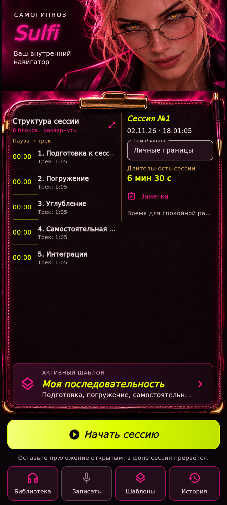
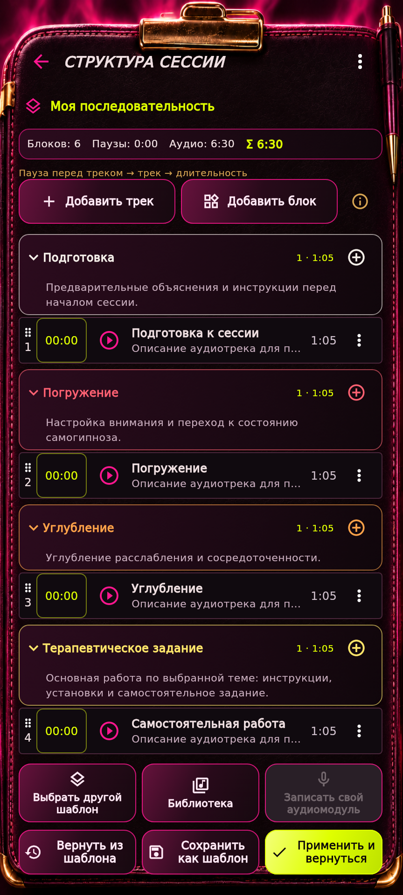
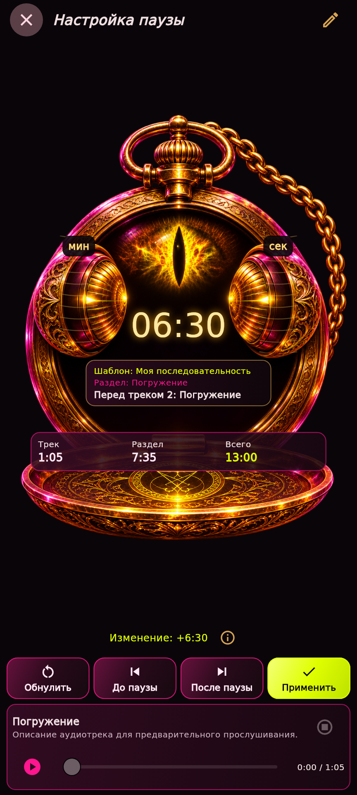

# Sulfi — самогипноз

Локальное Android/Flutter-приложение для составления аудиосессий. Версия разработки **0.2.2+4**, первый рабочий этап новой функциональной спецификации. `main` не изменяется, официальный релиз не опубликован.

## Исправления 0.2.2+4

- В структуре по умолчанию видны разделы «Подготовка», «Погружение», «Углубление», «Терапевтическое задание», «Интеграция», «Выход», каждый со своим цветом и описанием. Пустые разделы тоже отображаются. Кнопка + добавляет аудио в выбранный раздел; общий импорт выбирает раздел по категории, «Другое» можно назначить вручную. Существующий порядок дорожек не сортируется автоматически.
- У каждого нового трека есть отдельная пауза перед ним, включая первый: **00:00**. Подписи отделяют паузу от длительности аудио. Уже настроенные задержки сохраняются.
- В карточке явно подписана «Длительность сессии»: например, «1 мин 05 с». Пустой план показывает «Треки не добавлены».
- Страница часов целиком помещается на экране **без прокрутки**. Крутилки принимают только вертикальное движение; горизонтальное не меняет время и не вызывает haptics. Управление, применение и настоящий мини-плеер доступны без прокрутки. На маленьком экране сведения о разделе/суммах открываются через ⓘ; при крупном шрифте кнопки располагаются в два ряда.

[Пустые разделы с описаниями](docs/screenshots/sections-empty.png) · [Часы на 360×720](docs/screenshots/pause-small.png).

## Исправление компоновки 0.2.1+3

Главная сохраняет видимые кнопки запуска и навигации даже на 360×720. Убраны крупные вложенные карточки и повторное действие разворачивания; тема/заметка и компактная структура находятся непосредственно на кожаном планшете. В структуре уменьшены шапка и строки, справка открывается по значку ⓘ, обе нижние строки управления закреплены. Часы объединяют время, контекст и суммы внутри корпуса; четыре действия и готовый к прослушиванию мини-плеер расположены сразу ниже. Открытие часов не запускает аудио автоматически.

[Главная на небольшом экране](docs/screenshots/home-small.png). Оформление приближено к утверждённым референсам, все элементы управления остаются Flutter-виджетами. Данные, база и идентификатор Android не менялись.

## Что реализовано в этой итерации

- Главная с портретом Сульфи, тёмным рабочим планшетом, живыми часами телефона, темой/заметками, предварительным номером и текущей конфигурацией. Один ряд навигации.
- Полноэкранная структура: аудио, тишина и самостоятельная работа, разделы, сворачивание, перестановка, добавление/замена/дублирование/удаление. Один файл можно добавить несколько раз; у каждого экземпляра свой ID и своя пауза.
- Все новые паузы **перед блоками**, включая первый, по умолчанию `00:00`. Время самого аудио отображается отдельно.
- Золотые часы открываются по нажатию на время паузы. Левое колесо меняет минуты, правое — секунды с шагом 5. Тактильный щелчок на каждом принятом делении, ручной ввод и обнуление. До «Применить» изменения локальные. Есть предпрослушивание соседних треков и мини-плеер с перемоткой.
- Сохранённые шаблоны, текущая конфигурация и состоявшиеся сессии — **независимые сущности**. Рабочая конфигурация автосохраняется, не перезаписывая шаблон. История создаётся только после «Начать сессию».
- Шаблоны: создание, выбор с защитой правок, копирование, название/описание, базовый шаблон, удаление, сохранение рабочей конфигурации как нового шаблона. Обновление исходного шаблона — отдельная подтверждаемая команда в меню структуры.
- Библиотека сохранена и расширена: импорт MP3/M4A/WAV, внутренние копии, категории, три раздела «Общие / Установки / Мои», описания и метки, поиск, предпрослушивание, переименование и удаление. Файлы, используемые текущей конфигурацией/шаблонами, защищены от удаления.
- Выполнение последовательности **в открытом приложении**: задержки, аудио, тишина, самостоятельная работа, пауза/продолжение, следующий блок, продление работы на 5 минут, выход. При уходе в фон сессия прерывается; это явно показано до старта и в плеере.
- История: фактические времена, статус, события и прогресс, неизменяемый снимок настроек, переименование/заметка, повтор конфигурации и создание шаблона. После аварийного закрытия незавершённая запись помечается прерванной при следующем запуске.

**Ещё не реализованы:** диктофон, запись речи внутри сессии и темы голосом, Android foreground media service/фон/экран блокировки, зашифрованный экспорт данных. Кнопки записи явно недоступны; разрешение микрофона не запрашивается. В модели предусмотрен отдельный тип блока записи, но запуск такого плана отклоняется с пояснением. Полная приёмка K1–K10 пока не завершена.

## Как проверить новую версию

1. Импортировать собственное несекретное аудио через «Библиотека» → «Добавить аудио», задать название/описание/категорию.
2. Нажать «Добавить в сессию». В структуре добавить ещё аудио или блок тишины. Все паузы изначально нулевые.
3. Нажать `00:00` перед треком. Провести вверх/вниз по каждому колёсику или ввести `6:30`. До «Применить» конфигурация не меняется; после — обновляются только выбранная пауза и суммы. Закрытие без применения сохраняет прежнее значение.
4. Сохранить как шаблон, выбрать его, поменять паузу. Появится «Изменён»; исходный шаблон останется прежним. Перезапуск приложения должен восстановить рабочую конфигурацию.
5. Переставить или дублировать трек: задержка остаётся привязана к его экземпляру. Разделы сворачиваются без изменения порядка исполнения.
6. На главной ввести тему/заметку. До запуска истории нет. Нажать «Начать сессию»: сначала выполняется задержка перед первым блоком.
7. Проверить паузу, продолжение, завершение и «Завершить и выйти». При отсутствии аудиовыхода показывается текстовая ориентация. В истории — только фактически зафиксированные технические события.

Полный ручной план: [docs/ANDROID_TEST_PLAN.md](docs/ANDROID_TEST_PLAN.md). Результаты проверок: [docs/VERIFICATION_V2.md](docs/VERIFICATION_V2.md). Перед обновлением уже установленной версии прочитайте [ограничения подписи и сохранения данных](docs/UPGRADING.md).

## Экраны

Визуальные рендеры Flutter-тестов, не снимки физического Android. Использованы синтетические названия, тестовые длительности и локальный шрифт DejaVu Sans под семейством Roboto; на Android — штатный шрифт.

| Главная | Структура | Редактор паузы |
| --- | --- | --- |
|  |  |  |

## Настройка и команды

Flutter **3.47.9 stable** / Dart **3.13.7**, полный **JDK 21**, Android SDK **35 и 36**, Build Tools **36.0.0**, NDK **28.2.13676358**. Минимальный Android — **7.0 / API 24**. Прямые зависимости и lockfile закреплены. SDK 35 требуется аудиоплагину; приложение использует compile/target SDK 36.

```sh
git clone https://github.com/luxhypnomaster/sulfi-hypnotherapy.git
cd sulfi-hypnotherapy
git switch develop
flutter config --no-analytics
flutter doctor -v
sdkmanager 'platforms;android-35' 'platforms;android-36' 'build-tools;36.0.0' 'ndk;28.2.13676358'
flutter pub get --enforce-lockfile
dart format --output=none --set-exit-if-changed lib test
flutter analyze --fatal-infos
flutter test --reporter expanded
flutter build apk --debug
flutter run
```

APK: `build/app/outputs/flutter-apk/app-debug.apk`. Для arm64 отдельно: `flutter build apk --debug --target-platform android-arm64`. Последние универсальные debug APK находятся в [GitHub Actions](https://github.com/luxhypnomaster/sulfi-hypnotherapy/actions/workflows/checks.yml), раздел Artifacts; срок хранения — 14 дней. APK не является резервной копией личных данных.

При нестандартном пути SDK используйте `flutter config --android-sdk /путь/к/sdk`. Для JDK — `flutter config --jdk-dir /путь/к/jdk`. В среде с прокси Java/Gradle требуют отдельной локальной настройки GRADLE_OPTS и доверенных сертификатов; их значения/секреты не включаются в репозиторий. Первая установка инструментов требует интернета, приложение работает локально.

## Данные и миграция

`library.sqlite` и `audio/` находятся в закрытом `getApplicationSupportDirectory()`. SQLite **v2** обновляется с v1 добавлением полей и таблиц: прежние ID, имена и аудиофайлы не пересоздаются и не удаляются. Код категории `induction` сохранён для совместимости, отображаемое название заменено на «Погружение». Добавлена «Подготовка» и категория терапевтического задания.

- `SessionTemplate`: самостоятельный версионируемый образец.
- `CurrentSessionDraft`: единственная автоматически сохраняемая рабочая конфигурация, тема, заметки и исходный шаблон/версия.
- `SessionRun`: снимок на момент старта и фактические события. Последующие изменения библиотеки/шаблона не переписывают историю. Номера назначаются атомарно при старте и не используются повторно после удаления отдельной истории.

Предпрослушивание не создаёт сессий. Удаление записи истории не удаляет аудио. Полный локальный сброс из окна данных в библиотеке требует подтверждения и очищает все сущности. Удаление файла, используемого текущей конфигурацией/шаблонами, блокируется с перечнем зависимостей. При удалённом аудио старый снимок истории остаётся, но повтор потребует замены отсутствующего файла.

Нет API, облака, GPT, Suno API, синтеза речи, аналитики и передачи личного аудио. Голос Сульфи создаётся вне приложения и импортируется пользователем. Основной Android manifest не запрашивает INTERNET/микрофон; INTERNET в debug/profile нужен инструментам Flutter. Системное резервирование исключено; дополнительного шифрования пока нет, защита — sandbox Android. Физическое стирание флеш-памяти не гарантируется.

## Требования и границы этапа

[CODEX_TASK_RU.md](CODEX_TASK_RU.md) — новая функциональная спецификация. [docs/DECISIONS_V2.md](docs/DECISIONS_V2.md) фиксирует её применение, последние уточнения владельца и технические ограничения. [BACKLOG.md](BACKLOG.md) содержит следующие этапы.

Референсы — `docs/references/`. В приложении используются три подготовленных декоративных слоя **без надписей и кнопок**, `assets/art/`; текст, часы, управление, карточки и списки реализованы Flutter-виджетами. Крутилки имеют жесты и действия доступности, данные не считываются из изображений.

Версии и согласование: [VERSIONING.md](VERSIONING.md), изменения: [CHANGELOG.md](CHANGELOG.md). Работа в develop; main, теги и публикация релизов требуют отдельного согласования. Релизный workflow не публикует релиз сам: запускается после публикации владельцем, проверяет принадлежность main и версию. Пока нет постоянной подписи, APK с суффиксом debug предназначен для тестирования.
