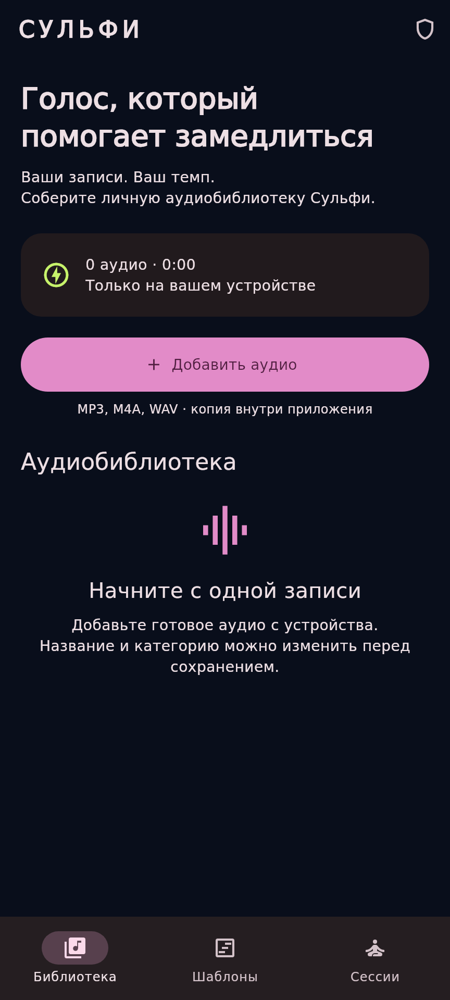

# Фактические проверки этапа 1

Дата: 2026-11-02. Ветка: develop. Платформа проверки: Linux x86_64; физический Android-телефон не подключён. Это результат разработки первого среза, не разрешение на публикацию релиза.

## Выполнено

| Проверка | Результат |
| --- | --- |
| `flutter pub get --enforce-lockfile` | Успешно; lockfile сохранён, прямые зависимости закреплены |
| `dart format --output=none --set-exit-if-changed lib test` | Успешно, 12 файлов, 0 изменений |
| `flutter analyze --fatal-infos` | `No issues found!` |
| `flutter test --reporter expanded` | `+28: All tests passed!` |
| Отдельный тест рендера интерфейса | `+1: All tests passed!`; получен docs/screenshots/library-empty.png |
| YAML файлов Actions | Синтаксис прочитан успешно; запуск на GitHub учитывается отдельно |
| `git diff --check` | Без ошибок |

Тесты хранения используют настоящие временные файлы и SQLite на Linux. Проверены отмена, ошибки источника/декодера, копирование, независимость от внешнего оригинала, одинаковые названия, редактирование, повторное открытие базы, удаление недостающего файла, очистка незавершённых копий и сброс. Экранные тесты проверяют импорт с редактором, ошибки сохранения, поиск, подтверждения, управление предпрослушиванием и остановку при уходе в фон, узкий экран и увеличенный шрифт.

Нативные picker/декодер/звук подменены в этих тестах. Настоящие MP3/M4A/WAV, Android audio focus, звонки, Bluetooth и поведение OEM **не проверены на устройстве**. Перед приемкой выполнить [ANDROID_TEST_PLAN.md](ANDROID_TEST_PLAN.md).

## Android-сборка

`flutter build apk --debug` реально запускался. Локальный APK пока не получен: после установки инструментов сборка дошла до Java/Kotlin-задач, но исчерпала доступный диск среды (7.9 ГБ; ошибка создания каталогов Gradle). Это ограничение среды, а не успешная сборка. Проверка на GitHub Actions запускается отдельно, результат нужно смотреть в Actions.

Начальные попытки также обнаружили отсутствие Flutter/Android SDK, Java runtime без javac, необходимость SDK 35 для аудиоплагина, настройку Java-прокси и доверенных сертификатов. Эти ограничения устранены установкой инструментов и локальной настройкой среды; проверка TLS не отключалась и адреса/секреты среды не включались в репозиторий. Установлен Temurin JDK 21.0.13, Android SDK 35/36 и Build Tools 36.0.0, NDK 28.2.13676358. Официальная релизная подпись не настраивалась.

## Визуальный артефакт



Изображение отрендерено Flutter widget-тестом при размере 432 × 960 логических пикселей; это **не снимок Android-устройства**. Для читаемой кириллицы в тест загружен локальный DejaVu Sans под семейством Roboto; в установленном приложении используется стандартный Flutter/Android шрифт. Иконки загружены из Flutter Material Icons.

Команда воспроизведения на машине с указанным шрифтом:

```sh
flutter test test/library_screen_test.dart \
  --plain-name 'optional UI preview artifact' \
  --dart-define=SULFI_SCREENSHOT_DIR=/tmp/sulfi-preview \
  --dart-define=SULFI_TEST_FONT=/usr/share/fonts/truetype/dejavu/DejaVuSans.ttf
```

## Что ещё не подтверждено

- Установка, реальное прослушивание и обновление без потери библиотеки на телефоне.
- Фоновое выполнение сессий, микрофон, безопасный выход и восстановление после прерываний — эти функции ещё не реализованы.
- Стабильная подпись и выпуск для распространения. Release-вариант не подписывается debug-ключом автоматически.
- Workflow для опубликованного владельцем релиза подготовлен, но не запускался: main не обновлялся, релиз и тег не создавались.
