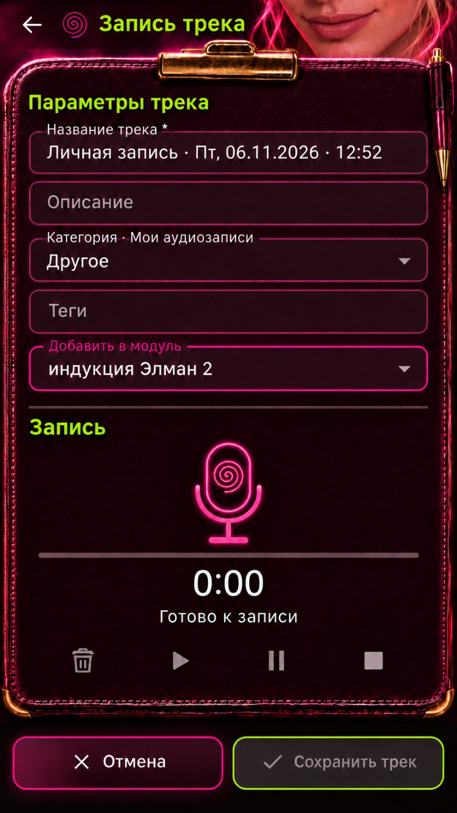
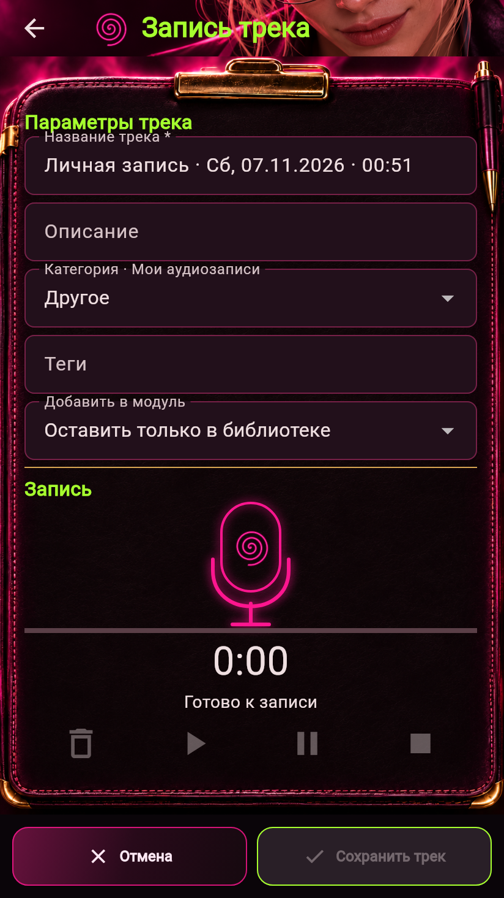

# Проверка композиции задания 4

Это реальные Flutter-рендеры интерактивных экранов с синтетическими данными. Звук и микрофон в тестах подставные; снимки не выданы за скриншоты установленного Android. Изображения из приложения не заменяют кнопки, поля и жесты.

| Утверждённый диктофон | Реализация 9:16 |
| --- | --- |
|  |  |

[Готов к записи](recorder-ready.png) · [Запись завершена](recorder-finished.png). Нормальная ширина 412 dp; 9:16 — 412×732, высокий экран — 412×915. Также проверены 320×640 и увеличенный шрифт 160%: поля прокручиваются, нижние действия доступны.

Единый мини-плеер: [главная](preview-home.png) · [структура](preview-structure.png) · [редактор модуля](preview-module.png) · [библиотека](preview-library.png). В каждом сценарии последовательно включаются два файла, проверяются пауза, перемотка и закрытие. Экран резервирует место под ту же панель, не перекрывая закреплённые действия.

Активный плеер: [начало](player/player-zero.png) · [пауза](player/player-paused.png) · [25%](player/player-25.png) · [75%](player/player-75.png) · [завершение](player/player-completed.png). Сохранены исходные декоративные части колбы и часов; управление и жидкость живые. Процент внизу колбы, счётчики справа. Дополнительные тесты проверяют независимую прокрутку, перемотку и завершение/сворачивание фазы.

Исходные пользовательские скриншоты с темами сессий не включены. Главная, библиотека и часы пауз сохраняют принятые композиции; окно паузы, его механические маховики и исходный сигил не менялись.
