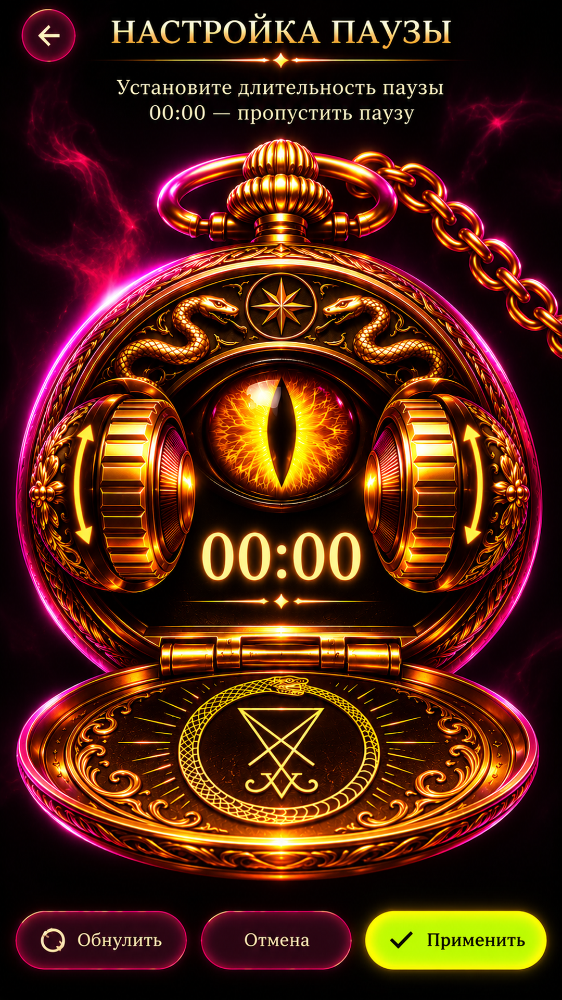
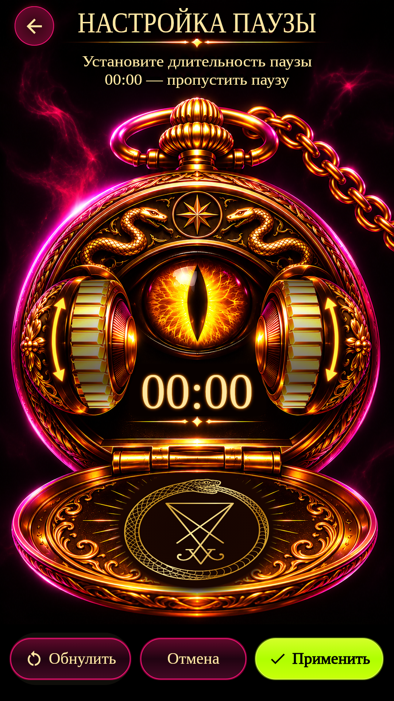

# Окончательная настройка паузы — 04.11.2026

Ветка `fix/pause-final-flywheels`, исходная точка `6f33380` — существующая версия
0.4.3+8. Новая тестовая сборка 0.4.4+9. Код/APK: `e3027ad`. [PR №6](https://github.com/luxhypnomaster/sulfi-hypnotherapy/pull/6). main/develop не изменяются, релиз не создан.
Это отдельная задача; после доставки работа останавливается для приёмки.

## Аудит и выполненное исправление

Раньше были два разных редактора, пятисекундная сетка без переноса минуты,
вспомогательные формы/мини-плеер и движущиеся линии поверх неподвижного орнамента.
Новая спецификация заменяет эти решения только для экрана настройки паузы.

Теперь `PauseEditor` и `PauseTimePicker` используют один `ApprovedPauseClock`.
Композиция масштабируется целиком в SafeArea без прокрутки. В центре одно живое
табло; на маховиках нет дополнительных цифр. Настоящие кнопки расположены одной
строкой: Обнулить / Отмена / Применить, последняя лаймовая. Полей, переключателей,
описания, мини-плеера, дополнительных действий и конкурирующего диалога нет.

На всей видимой поверхности каждого большого маховика работают вертикальные
жесты. Вверх увеличивает, вниз уменьшает; горизонтальное движение и простой тап
не меняют время. Мелкие сдвиги накапливаются; отмена/новое касание сбрасывают
остаток жеста без скачка. Цилиндрические зубцы с фактурой из эталона проецируются
через sin угла, сжимаются у краёв и движутся с пальцем; торцевые диски вращаются
в эллиптической проекции. Это движущаяся поверхность, без вращения всего рисунка
вокруг оси экрана. Движение между числовыми делениями подтверждено сравнением
пикселей при неизменном значении таймера. Семантика Минуты/Секунды поддерживает
increase/decrease; haptic selectionClick запрашивается только на принятом делении.

Единственный источник значения — целое количество секунд. Левый маховик меняет
целые минуты, сохраняя секунды; правый меняет секунды по одной, с переносом
00:59→01:00 и обратно. Сохранён **существующий валидированный предел 99:55**;
условие кратности пяти снято. Для сохранения одной секунды потребовалось изменить
только эту проверку в SessionController. Очередь сохранения, воспроизведение,
модели сессий и схема SQLite v4 не менялись.

Применить записывает значение в исходный объект, затем закрывает экран. Обнуление
и повороты до применения не пишут данные; Отмена/системный возврат их отбрасывают.
Повторное открытие показывает сохранённое значение. Длинные существующие интервалы
свыше 99 минут показывают фактическое значение без автоматического усечения;
новые настройки используют общий предел. Старые бессрочные элементы не изменяются
при отмене; явное применение длительности преобразует их в конечную паузу, без
нового переключателя режима. Аудио, история, шаблоны и другие экраны сохранены.

## Графические источники и сравнение

Имена в заголовке ТЗ отличаются от архива; использованы реальные имена из его
README_FIRST_RU.txt. Исходные файлы не редактировались:

- `PAUSE_APPROVED_9x16_1080x1920.png` → `assets/pause/approved.png`, SHA-256
  `92862d0cdc124e2b7e6c26cdab23aa42bb694d22222c7ea0f861bb1a94d32943`.
- `SIGIL_USER_ORIGINAL.png` → `assets/pause/sigil.png`, SHA-256
  `9fac135feac9f15e8cc60b38dc199a58d534997deeb323b6f21efdf09fb3f966`.
- Символ берётся из точного bitmap, белый фон становится прозрачным при отрисовке,
  исходные линии получают золотое освещение. Геометрия не перерисовывается.
- Запечённое время и предыдущий символ маскируются во время отрисовки; старое
  табло не остаётся под новыми цифрами. Заголовок, инструкция, табло и кнопки —
  реальные Flutter-виджеты, типографика локальна для этой страницы.

| Эталон | Работающий Flutter-экран |
| --- | --- |
|  |  |

Полноразмерные скриншоты: `/workspace/artifacts/pause-final/pause-00-00.png`,
`pause-06-32.png`, `pause-tall-large-text.png`. Это рендер настоящих Flutter-виджетов
с теми же ресурсами/шрифтом, что в APK, **не снимки физического телефона**.
Демонстрация: `/workspace/artifacts/pause-final/flywheels-demo.mp4`, H.264,
720×1280, 11 секунд. Кадры сняты во время настоящих tester pointer gestures;
белый кружок показывает место пальца только в тестовом стенде, в APK его нет.
Показаны оба маховика, обратный ход, переход 06:58→07:04 и обнуление.

## Проверки

- `flutter pub get --enforce-lockfile` — PASS.
- `flutter analyze --fatal-infos` — PASS.
- `dart format --output=none --set-exit-if-changed lib test` — PASS.
- `flutter test --reporter expanded` — **185 PASS**, включая **21 новый тест**.
- Отдельный запуск с `SULFI_PAUSE_ARTIFACT_DIR=/workspace/artifacts/pause-final`
  сохранил рабочие скриншоты и кадры видео. `ffprobe` подтвердил кодек/размер/длительность.
- Локально `flutter build apk --debug --no-pub --target-platform android-arm,android-arm64` — **PASS**.
- [GitHub Actions 41890986608](https://github.com/luxhypnomaster/sulfi-hypnotherapy/actions/runs/41890986608) — **SUCCESS**: format, analyze, все 185 Flutter-тестов, прежние Node-тесты и универсальный debug APK.
- aapt подтвердил applicationId `ru.sulfi.sulfi_hypnotherapy`, versionName 0.4.4 / versionCode 9. apksigner и ZIP CRC — PASS. SHA-256 обоих графических исходников внутри APK совпали с архивом.
- `adb devices -l` — устройств нет. Физическая установка/управление не выполнялись.

| Пункты ТЗ | Результат / свидетельство |
| --- | --- |
| 1–2: минуты/секунды, оба направления, перенос | PASS, unit + реальный drag до отпускания пальца |
| 3: фон/глаз/горизонталь/тап стрелки | PASS, время не меняется |
| 4: мгновенное табло и движение металла | PASS, pointer-down assertion + сравнение пикселей между делениями + MP4 |
| 5: мелкие/быстрые/прерывистые жесты | PASS, накопление и pointer cancel, новый контакт без остатка |
| 6: нижняя граница | PASS, нет отрицательных секунд; верхняя также проверена |
| 7–10: reset/cancel/apply/reopen/system back | PASS, реальный маршрут и проверка исходного объекта |
| 11: создание/редактирование в модуле/сессии | PASS, оба настоящих конструктора открывают общий экран |
| 12: перестановка/удаление сохраняют длительности | PASS, реальный long press, ID и 2/5 секунд сохранены |
| 13: сравнение композиции | Выполнено, таблица выше; физическая приёмка владельцем остаётся |
| 14–17: точный сигил, одно табло, большие ролики, отсутствие лишнего UI | PASS, исходные SHA-256, реальные виджеты и просмотр скриншота |
| 18: три доступные кнопки и лаймовое применение | PASS, hit tests, крупный шрифт, просмотр рендера |
| 19: другие пропорции и системные панели | PASS, 320×600 / 360×640 / 412×915, отступы 24, масштаб текста ×2, DPI ×2/×3 |

На физическом Android НЕ проверены тактильное ощущение и отключение вибрации
в настройках ОС, частота кадров/скорость пальца, TalkBack и установка обновления.
Тесты подтверждают запросы selectionClick; соблюдение системной настройки поручено
штатному HapticFeedback. Это не заявление о проверке реального вибромотора.

## Каждый изменённый файл

- `lib/services/pause_edit_model.dart` — локальное целое значение, арифметика и границы.
- `lib/services/session_controller.dart` — только снятие сетки %5 в валидации задержки.
- `lib/ui/mechanical_wheel.dart` — жесты, цилиндрическая поверхность, доступность/haptic.
- `lib/ui/pause_clock_art.dart` — единственная утверждённая композиция и живые контролы.
- `lib/ui/pause_editor.dart` — адаптер сохранения задержки перед исходным треком.
- `lib/ui/pause_time_picker.dart` — адаптер значения для обоих конструкторов.
- `assets/pause/approved.png`, `assets/pause/sigil.png` — точные исходные файлы из архива.
- `assets/pause/LiberationSerif-Regular.ttf`, `assets/pause/FONT_LICENSE.txt` — локальная типографика/лицензия.
- `pubspec.yaml` — ресурсы/шрифт и Android versionCode 9.
- `test/pause_final_test.dart` — 21 новая функциональная/визуальная проверка.
- `test/session_storage_test.dart` — реальное сохранение секунд вне прежней сетки.
- `test/workspace_screen_test.dart` — ожидания утверждённого UI вместо отменённых форм/плеера.
- `docs/pause-final/TASK_RU.md`, `docs/pause-final/README_FIRST_RU.txt` — исходное задание.
- `docs/pause-final/actual-00-00.png` — рабочий скриншот.
- `README.md`, `BACKLOG.md`, `CHANGELOG.md`, `reports/pause_final.md` — версия, приёмка и этот отчёт.


Других исходников/экранов, схемы БД, движка, диктофона, дневника или библиотеки в
изменениях этой задачи нет. Ветка продолжает предыдущую разработку без её переписывания.


## Сборка и доставка для приёмки

- **[APK 0.4.4+9 для Android-телефонов](https://drive.google.com/file/d/1EhKGnWSU8NkEf29KFHhCQ_lo--cma6QW/view)** — ZIP с одним APK, 86951736 байт. В архиве `sulfi-0.4.4+9-arm-debug.apk`, 146172319 байт. Flutter engine для ARMv7/ARM64; x86_64 Flutter engine в локальную сборку не включён из-за лимита диска. В APK есть некоторые сопутствующие JNI-библиотеки x86_64, но это не поддержка запуска Flutter на x86_64.
- **[Рабочий скриншот](https://drive.google.com/file/d/1gKk9D80--AqMNxmeym567AED_Q8Wu8Fx/view)** — PNG 1080×1920, 2763228 байт.
- **[Демонстрация маховиков](https://drive.google.com/file/d/1PjMh4kyENXJSc0CLYgUx9rb5XfYMgAp6/view)** — MP4, 11 секунд, 676419 байт.
- Загрузка и обратное чтение metadata всех трёх файлов подтверждены: размеры совпадают, shared=false, только owner. Это закрытые файлы в папке владельца «Сульфи».
- [Универсальный APK в CI](https://github.com/luxhypnomaster/sulfi-hypnotherapy/actions/runs/41890986608/artifacts/13354382562), артефакт до 18.11.2026. У CI собственный debug certificate; его нельзя считать совпадающим с локальным.

Локальный APK подписан **тем же сертификатом, что предыдущая сборка 0.4.3+8 на Диске** — это проверено сравнением SHA-256 сертификатов, вместе с неизменным applicationId и увеличенным versionCode. Реальная установка поверх предыдущей версии ещё не проверена. При отказе Android обновляться не удалять старое приложение ради обхода подписи: это удаляет личные данные.

SHA-256 APK: `1a661b9a0774a528f42ef402cbc4c794fa779ca7dcc3c9b3a60117be7cb7c60a`.
SHA-256 ZIP: `dde97ae724a6024cb95f7ebe04aa331e4c7ac710a926bf911602ed304706d759`.
Локальные копии и BUILD.json: `/workspace/artifacts/pause-final/`.

Первая локальная универсальная попытка упёрлась в заполнение диска на stripDebugDebugSymbols; целевая сборка ARMv7/ARM64 завершилась успешно. Для Gradle использованы штатные proxy/CA среды с сохранённой TLS-проверкой и воспроизводимые кеши в RAM. Очищались только промежуточные build-файлы и кадры, уже закодированные в MP4. Старый APK/архив, исходные пользовательские ресурсы и аудиоданные сохранены.

## Короткая приёмка на телефоне

1. Установить APK поверх предыдущей версии, проверить наличие своей библиотеки, шаблонов и истории.
2. Открыть сохранённую паузу: должно показываться её время. Вести вверх/вниз по всей поверхности обоих маховиков, проверить направление и перенос через 59 секунд. Горизонтальный жест/тап стрелки время не меняет.
3. Обнулить → Отмена и системный возврат: прежнее значение остаётся. Обнулить → Применить: после повторного открытия 00:00. Применить ненулевое время: оно восстанавливается в нужной паузе.
4. Повторить в модуле и структуре сессии; переставить/удалить соседнюю паузу, проверить исходные длительности.
5. Проверить крупный шрифт/вырез/системную панель: все три действия доступны без прокрутки. Проверить TalkBack, затем отключить системную вибрацию и убедиться, что тактильные деления отключились.

После доставки этой одной задачи работа остановлена для приёмки. Следующие подсистемы не начаты.

## Полный diff --stat относительно исходной версии

<!-- pause-diffstat -->
```text
 BACKLOG.md                               |  11 +
 CHANGELOG.md                             |   8 +
 README.md                                |   8 +-
 assets/pause/FONT_LICENSE.txt            | 130 ++++++
 assets/pause/LiberationSerif-Regular.ttf | Bin 0 -> 393692 bytes
 assets/pause/approved.png                | Bin 0 -> 2763501 bytes
 assets/pause/sigil.png                   | Bin 0 -> 186163 bytes
 docs/pause-final/README_FIRST_RU.txt     |  14 +
 docs/pause-final/TASK_RU.md              | 107 +++++
 docs/pause-final/actual-00-00.png        | Bin 0 -> 2763228 bytes
 lib/services/pause_edit_model.dart       |  53 +--
 lib/services/session_controller.dart     |   6 +-
 lib/ui/mechanical_wheel.dart             | 285 +++++++++----
 lib/ui/pause_clock_art.dart              | 558 ++++++++++++++++++++-----
 lib/ui/pause_editor.dart                 | 568 +------------------------
 lib/ui/pause_time_picker.dart            | 130 ++----
 pubspec.yaml                             |   7 +-
 reports/pause_final.md                   | 180 ++++++++
 test/pause_final_test.dart               | 688 +++++++++++++++++++++++++++++++
 test/session_storage_test.dart           |   7 +-
 test/workspace_screen_test.dart          |  52 ++-
 21 files changed, 1908 insertions(+), 904 deletions(-)
```
<!-- /pause-diffstat -->
